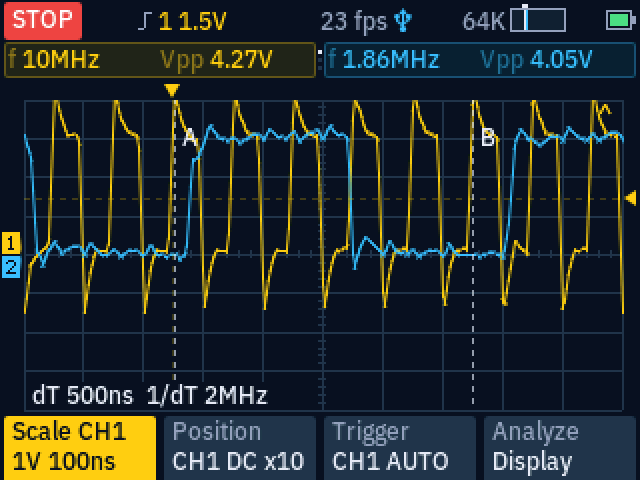
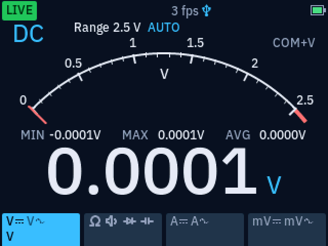
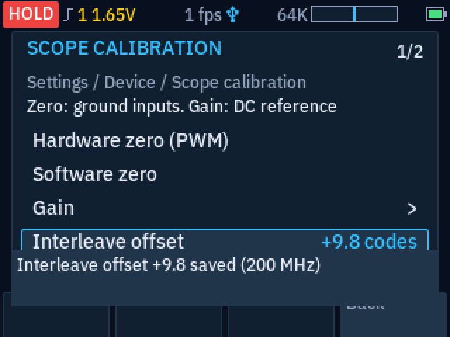
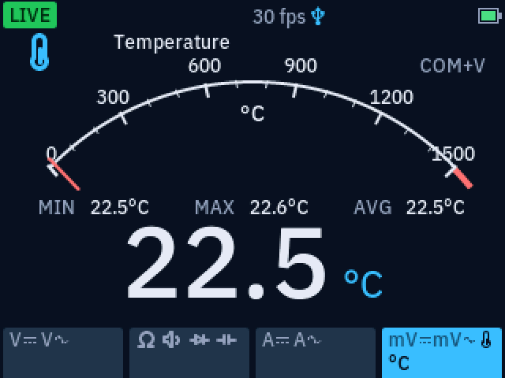
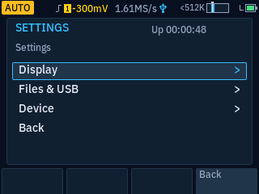

# OpenOSC

[](https://github.com/bve/OpenOSC/releases)
[](https://github.com/bve/OpenOSC/releases)
[](https://github.com/bve/OpenOSC/releases)
[](https://github.com/bve/OpenOSC/releases/latest)
[](https://github.com/bve/OpenOSC/stargazers)

Open-source firmware for the **ZT703S** and **ZT706S** handheld oscilloscope multimeters.

OpenOSC replaces the stock application with its own oscilloscope, multimeter and signal generator
firmware. It also adds a small Recovery bootloader that updates the firmware from a USB drive.

**Documentation:** the [wiki](https://github.com/bve/OpenOSC/wiki) has a user guide for every
instrument, the SCPI reference, troubleshooting and pages for contributors.

> **Status:** work in progress. ZT703S is the main development and test device.
> **ZT706S:** I don't have one. Users run it, but many features are untested on that model.
> **Clones of the ZT703S and ZT706S** should work too: install the files for the model they are based on.
> If something does not work on a clone, please [open an issue](https://github.com/bve/OpenOSC/issues/new/choose).

> [!WARNING]
> **This firmware is for enthusiasts only.** If you are generally happy with the stock firmware,
> I do not recommend installing OpenOSC.
>
> **I take no responsibility for bricked or damaged devices.** You install this firmware entirely
> at your own risk.

> [!NOTE]
> **You can always go back to the stock firmware.** OpenOSC never modifies the factory bootloader,
> your calibration or the factory settings. The factory bootloader still accepts official updates,
> so installing the official firmware replaces OpenOSC completely.
> See [Going back to the stock firmware](#going-back-to-the-stock-firmware).

## Screenshots

Captured on a ZT703S running OpenOSC.

<table>
  <tr>
    <td></td>
    <td></td>
  </tr>
  <tr>
    <td align="center">Oscilloscope, two channels</td>
    <td align="center">Multimeter with charge counter</td>
  </tr>
  <tr>
    <td></td>
    <td></td>
  </tr>
  <tr>
    <td align="center">Two readouts per channel, time cursors</td>
    <td align="center">Multimeter, large reading</td>
  </tr>
  <tr>
    <td></td>
    <td></td>
  </tr>
  <tr>
    <td align="center">CH1 interleave on the ZT703S (experimental)</td>
    <td align="center">Interleave offset calibration</td>
  </tr>
  <tr>
    <td></td>
    <td></td>
  </tr>
  <tr>
    <td align="center">Bode analyzer</td>
    <td align="center">Type K temperature</td>
  </tr>
  <tr>
    <td></td>
    <td></td>
  </tr>
  <tr>
    <td align="center">Protocol decoder: split view (SPI)</td>
    <td align="center">Protocol decoder: CAN table</td>
  </tr>
  <tr>
    <td></td>
    <td></td>
  </tr>
  <tr>
    <td align="center">Protocol decoder: I²C table</td>
    <td align="center">CAN FD frame detail</td>
  </tr>
  <tr>
    <td></td>
    <td></td>
  </tr>
  <tr>
    <td align="center">Protocol decoder: UART table</td>
    <td align="center">UART baud rate detection</td>
  </tr>
  <tr>
    <td></td>
    <td></td>
  </tr>
  <tr>
    <td align="center">Multimeter, analog view</td>
    <td align="center">Signal generator</td>
  </tr>
  <tr>
    <td></td>
    <td></td>
  </tr>
  <tr>
    <td align="center">Multimeter HOLD modes</td>
    <td align="center">Auto HOLD</td>
  </tr>
  <tr>
    <td></td>
    <td></td>
  </tr>
  <tr>
    <td align="center">Daylight color scheme</td>
    <td align="center">Amber color scheme</td>
  </tr>
  <tr>
    <td></td>
    <td></td>
  </tr>
  <tr>
    <td align="center">Settings with uptime</td>
    <td align="center">Generator layout</td>
  </tr>
  <tr>
    <td></td>
    <td></td>
  </tr>
  <tr>
    <td align="center">FFT with cursors</td>
    <td align="center">XY mode</td>
  </tr>
</table>

## Features

**Oscilloscope**

- Two channels, 20 mV/div to 10 V/div, timebase from 10 ns/div to 20 s/div
- Trigger modes Auto, Normal and Single, with adjustable pre/post-trigger position and Center trigger.
  Tap **F3** to select Trigger and use Left/Right to adjust pretrigger. Tap **F3** again to cycle modes.
  Hold **F3** to set the trigger level to the signal midpoint and pretrigger to 50%. Pan with **F2**
- Continuous Roll mode for slow timebases (200 ms/div and slower)
- Record memory from 64K to 512K points across enabled channels. The record overview shows the
  budget used for the displayed capture. A label such as `<512K` indicates a shorter capture.
  **Analyze → Acquisition → Captured** shows the exact number of points per channel.
- In the default **Quick** profile, tap **AUTO** to start Auto Setup or cancel it in progress.
  Hold **AUTO** for 2 s in Y-T to open **Zoom & Pan**. Up/Down zoom the view, Left/Right pan, and
  **F4** returns to the previous card. The **Classic** profile uses a tap to reset pan and a hold to
  start Auto Setup. Choose the profile and the **F2**/**F4** hold actions in **Settings → Display → Scope shortcuts**
- Hold **F1** to choose the selected channel's probe ratio, including 10000:1 (**X10K** on the Position card).
  Hold **F2** for Home view or Reset zoom & pan. Hold **F4** to open the assigned editor.
  Returning from the Cursor settings shortcut selects the first enabled cursor for arrow-key control
- Configurable on-screen measurements, two per channel in the footer, time and level cursors
- Hardware frequency counter with an averaged on-screen overlay
- XY, MATH and reference waveforms; sin(x)/x and spline interpolation, fading or infinite persistence, Glow
- Per-channel waveform density (**Channel → Density**) in Y-T and Y-T+FFT. Choose **Colors** to show
  rare paths in cooler colors and frequent paths in warmer colors, or **Mono** with a selectable color.
  Density defaults to **Off**. Its history follows **Analyze → Display → History → Persistence**.
  Density uses a 1 s history with Persistence Off. **Infinite** keeps every observed path, and
  **Clear history and reference** starts a new accumulation
- Grid brightness (**Analyze → Display → View → Grid brightness**, 0–100 %) and a separate trace
  brightness for CH1 and CH2 (**Channel → Trace brightness**, 10–100 %). Both dim towards the plot
  background on dark and light schemes. Trace brightness also applies to Peak Hold, Persistence, Glow,
  X-Y (CH1) and Density. Channel colors, labels and markers keep full contrast
- FFT up to 2048 points with four window functions, dBFS or linear scale
- Protocol decoders (**Analyze → Decoder**): UART with autobaud, I²C, SPI, LIN, CAN and ISO CAN FD.
  Waveform with annotations, split or table view, event detail; decoded data saved as CSV
- Bode analyzer (**Analyze → Bode (FRA)**): gain and phase of a circuit against frequency with the
  built-in generator, cursors, −3 dB points, bandwidth, gain and phase margins, CSV export
- Zero and gain calibration of both channels, stored as files and never written to the factory calibration
- Selectable performance profiles: 200/100, 280/140 and 360/90 (core MHz / MS/s per channel),
  switched instantly without a restart
- CH1 interleave over both ADCs, up to 280 MS/s on CH1 alone. Both models offer Off, On and Auto.
  On the ZT703S, interleave is experimental, with on-device offset and gain/timing calibration.
  Its Auto mode follows the MKR rule: CH1 alone at 10 or 25 ns/div on the 200 and 280 MHz profiles,
  except in Roll or while the generator streams from the DAC. On interleaves CH1 alone at every timebase
  and profile. The ZT703S defaults to Off and the ZT706S to Auto (the stock rule)
- Save waveforms as RAW or CSV

**Multimeter**

- DC/AC voltage, millivolts, DC/AC current and milliamps, resistance, continuity, diode, capacitance
- Type K thermocouple temperature in °C or °F. In **Measurement → Junction source**, choose **Manual** (25 °C by default), **MCU at startup**, or **MCU live**. The startup option holds the die temperature captured when the firmware launches. The live option updates it about once a second. As the instrument warms up, die temperature can diverge from the temperature at the thermocouple terminals.
- Auto and manual ranges (the AUTO/RANGE key works as in the stock firmware) and REL
- HOLD modes (**MENU → Measurement → Hold**): Manual, Delayed (after a countdown), Stable (waits
  for a stable reading) and Auto (holds every new stable reading)
- Statistics, trend chart and CSV logging
- Ampere-hour counter in DC current (A and mA): the signed charge since the function was selected,
  shown as mAh or Ah beside the range. It counts while the readings are valid and arrive at most 2 s
  apart (an overload, the meter's own HOLD or REL, a lost or corrupted reading, or a longer gap pauses
  it, with nothing estimated for the missing time). Manual HOLD and REL change only the display. A
  confirmed switch to another function or entering the multimeter screen resets it; a range change or
  a repeated selection of the same function keeps it.
- Large 72/80 px reading when the bar graph and statistics are off
- Bar graph labels follow the active range in measurement units. The 2.5 V range, for example, runs from 0 to 2.5 V in 0.5 V steps. The analog dial labels its scale in the reading's unit

**Signal generator**

- Six waveforms: sine, square, triangle, half sine, positive sine and sawtooth
- Digit-by-digit frequency entry; duty cycle for square
- Keeps running in the background while you use the oscilloscope or the multimeter
- Output is OFF after power-on by default, or restores its last state
  (**Settings → Device → Power → Generator at startup**)
- Rearrangeable screen (**Settings → Display → Generator layout**)
- ZT703S: square output as in the stock firmware (DAC below 1 kHz, PWM from 1 kHz) or PWM
  always; Reference 1 kHz preset
- ZT706S: its external generator module, up to 10 MHz

**USB and remote control**

- USBTMC and CDC (virtual COM port) with SCPI commands, working alongside the local UI
- [SCPI extensions for desktop clients](docs/SCPI_DESKTOP.md) for frame, peak, measurement and file transfers
- Compatible command profiles for Rigol DS oscilloscopes and the OWON XDM1041 multimeter, so
  existing PC software such as ngscopeclient can talk to the device
- USB Remote mode: the PC controls the device while the screen keeps showing live data
- USB data works only in the 200/100 performance profile. Connect directly to a PC port:
  disconnects are known, especially through USB hubs.

**Interface and files**

- LVGL-based user interface (English only)
- The Settings header shows the time since the firmware started (hours, minutes and seconds)
- Rearrangeable screens: on the oscilloscope, choose the order of the waveform, the measurements
  and the soft-keys (**Analyze → Layout**); on the multimeter, the order of the reading, the
  statistics/bar/trend, the dial and the soft-keys (**MENU → Layout**). Soft-keys are at the
  bottom by default, in the same order as the physical F1–F4 keys
- The labels above F1–F4 always show what each key does right now; in menus they stay at the
  bottom, right above the keys
- Oscilloscope color schemes (**Analyze → Colors**): Current, High contrast, Daylight and Amber,
  plus custom RGB colors for individual elements. Multimeter looks: Custom and Hybrid
- BMP screenshots with a built-in viewer
- Settings and the color theme are stored as JSON files on the external SPI Flash and saved when
  you switch the device off, restart it or enter Recovery. The microcontroller's internal Flash
  holds only the firmware. You can edit the files from a computer; a damaged settings file is
  restored from its previous version or from a copy in `/openosc/SETCOPY/`.
- Hold-to-power-off with a progress bar
- Hardware watchdog in both the firmware and Recovery: a hang or a crash restarts the device

**Recovery bootloader**

- Shows the device storage as a USB drive and installs firmware from `/openosc/UPDATE/`
- Accepts `.OSC` packages and raw `.bin` images; verifies the board model and CRC before erasing
- Shows the factory calibration data and its format (long or compact) and can save a copy of the
  factory Flash block
- Checks and repairs the FAT file system, and can format the storage drive
- Opens automatically if the main firmware is missing or invalid

## How it works

The device's own factory bootloader occupies the first 128 KiB of internal Flash. OpenOSC never
modifies it. OpenOSC is installed on top of it in two parts:

| Part | Address | Purpose |
| --- | --- | --- |
| Factory bootloader | `0x08000000` | Untouched, together with the calibration and factory settings stored in the same block. Accepts the stock `.ZTK` update containers. |
| OpenOSC Recovery | `0x08020000` | Second-stage bootloader (128 KiB). Exposes a USB drive and installs the main firmware. |
| OpenOSC firmware | `0x08040400` | The main application. |

## Installation

Installation takes two steps. First, the Recovery bootloader is installed through the device's
standard firmware update mechanism. Then Recovery installs the OpenOSC firmware.
The same steps, with more detail, are in the wiki: [Installation](https://github.com/bve/OpenOSC/wiki/Installation)
and [Updating](https://github.com/bve/OpenOSC/wiki/Updating).

### Step 1: install the Recovery bootloader (standard update)

Recovery is packed as a regular factory update container (`.ZTK`):

- ZT703S: `OpenOSC-Recovery-ZT703S.ZTK`
- ZT706S: `OpenOSC-Recovery-ZT706S.ZTK`

The bootloader reads the target model from the file header. On most units the file name can be
changed, as long as it keeps the upper-case `.ZTK` extension.

> [!IMPORTANT]
> **If Recovery does not install** (the file disappears from the drive, but the stock application
> still starts), rename the file to `ZOYI-703S-FW-V143.ZTK` and copy it again. Some ZT703S units
> (Boot v1.0.15) install only files with this kind of name
> ([#16](https://github.com/bve/OpenOSC/issues/16)).
>
> If a large `.ZTK` does not fit on the drive ("not enough free space"), free up the device's storage
> or format it from the stock application: **Scope → MENU → Apps → Image Viewer → F1 → Format (F3)**.

Install it the same way as an official firmware update:

1. Put the device into the factory USB update mode and connect it to a computer.
2. Copy the `.ZTK` file for your model into the `firmware` folder on the drive that appears.
3. Wait until the bootloader finishes. It installs the file and deletes it from the drive.
4. The device restarts into OpenOSC Recovery; restart it manually if it does not.
   The stock application has been replaced, so Recovery opens its menu.

### Optional: back up the factory block

**This step is optional.** You can skip it and go straight to step 2.

OpenOSC never writes to the factory block. The only Flash write code in OpenOSC accepts addresses
from `0x08040000` upward, the firmware area, so neither Recovery nor the firmware can erase or
change the factory block, even by mistake. Installing, updating and running OpenOSC leave it
exactly as it was.

The backup is a precaution for rare events outside OpenOSC, such as a hardware fault. If you want
one:

1. In Recovery, select **BACKUP FACTORY BOOT**, then **CONFIRM** and press **MENU**.
2. Recovery copies the whole factory block (`0x08000000`–`0x0801FFFF`, 128 KiB) to the USB drive
   and verifies the copy:
   - `/openosc/BACKUP/FACTORY_BOOT_08000000.bin`: the backup itself;
   - `/openosc/BACKUP/FACTORY_BOOT_08000000.txt`: its address, size and CRC32.
3. Copy both files from the USB drive to your computer and keep them somewhere safe.

The block contains the factory bootloader and **this unit's own calibration and settings**.
Keep a separate backup for each device and never write one device's backup to another.
Writing a backup back requires an SWD programmer.

### Step 2: install the OpenOSC firmware (through Recovery)

1. Start Recovery. It opens automatically when no valid firmware is installed.
   Later, you can open it by holding **F2** while the device starts.
2. Connect the device to a computer. Recovery shows the device's storage as a USB drive.
3. Copy the firmware file for your model into `/openosc/UPDATE/`: `OpenOSC-Firmware-ZT703S.OSC` or
   `OpenOSC-Firmware-ZT706S.OSC` (from the release or your own build).
4. Finish copying. Optionally, eject the drive on the computer.
5. On the device, select **UPDATE FIRMWARE**, choose the file, select **CONFIRM** and press **MENU**.
6. When the update completes, select **START APPLICATION**.

Recovery controls: **MENU** = OK, **F4** = back/cancel, arrow keys = navigation.
Every confirmation starts on **CANCEL**: press left/right to select **CONFIRM**, then **MENU**.
If the computer still has the USB drive mounted, Recovery first asks **DISCONNECT USB DISK?**.
Confirm it and Recovery detaches the drive itself; the cable can stay connected.

Recovery checks the board model, CRC and vector table of the image before erasing anything.
An image for another model is rejected. Later updates of the main firmware use step 2 only.

### Going back to the stock firmware

You can return to the stock firmware at any time. OpenOSC only replaces the application area. The
factory bootloader is never modified, and it starts before OpenOSC every time the device is
switched on.

1. Get the official firmware update (`.ZTK`) for your model from the manufacturer. It is a good idea
   to download it before you install OpenOSC.
2. Install it exactly like [step 1](#step-1-install-the-recovery-bootloader-standard-update):
   put the device into the factory USB update mode and copy the file into the `firmware` folder.
3. The factory bootloader replaces OpenOSC Recovery and the OpenOSC firmware with the stock
   application.

The calibration and the factory settings are stored in the factory block, which OpenOSC never
writes, so the stock firmware uses them as before. OpenOSC's own files in the `/openosc/` folder
on the storage drive are not needed by the stock firmware and can be deleted.

The [factory block backup](#optional-back-up-the-factory-block) is not needed for this. It is a
safety copy for the unlikely case that the block itself is ever damaged.

## Building

Requirements: [PlatformIO](https://platformio.org/). The ST platform and the ARM toolchain are
pinned in `platformio.ini` and installed automatically.

```sh
pio run
```

This builds both devices. Output files:

| Device | Recovery (step 1) | Firmware (step 2) |
| --- | --- | --- |
| ZT703S | `.pio/build/recovery/OpenOSC-Recovery-ZT703S.ZTK` | `.pio/build/firmware/OpenOSC-Firmware-ZT703S.OSC` |
| ZT706S | `.pio/build/zt706s_recovery/OpenOSC-Recovery-ZT706S.ZTK` | `.pio/build/zt706s_firmware/OpenOSC-Firmware-ZT706S.OSC` |

Each build folder also contains `firmware.bin`. For the firmware environments, this `.bin`
has a board marker and Recovery accepts it as well.
To build one device only, run, for example, `pio run -e recovery -e firmware` for ZT703S.

The firmware version is taken from [`VERSION`](VERSION).

## Third-party components

All dependencies are included in [`vendor/`](vendor):

- STM32CubeH7: CMSIS, HAL and USB Device library (ST)
- CMSIS-DSP (Arm, Apache-2.0)
- FatFs (ChaN)
- LVGL 9.6.0 (MIT)
- ArduinoJson 6.21.5 (MIT)
- IBM Plex Sans and Noto Sans Mono fonts (SIL OFL 1.1)

Each component keeps its own license file.

## Contributing

Bug reports, ZT706S test results and pull requests are welcome. See [CONTRIBUTING.md](CONTRIBUTING.md)
and the [Code of Conduct](CODE_OF_CONDUCT.md). Questions go to
[Discussions](https://github.com/bve/OpenOSC/discussions); security problems are reported as described
in [SECURITY.md](SECURITY.md).

For the code base, see the contributor pages in the wiki:
[Building](https://github.com/bve/OpenOSC/wiki/Building),
[Architecture Overview](https://github.com/bve/OpenOSC/wiki/Architecture-Overview),
[Source Layout](https://github.com/bve/OpenOSC/wiki/Source-Layout) and
[Memory and Flash Layout](https://github.com/bve/OpenOSC/wiki/Memory-and-Flash-Layout).

## License

OpenOSC is licensed under the [GNU General Public License v3.0](LICENSE).

All product names and trademarks belong to their respective owners. This project is not
affiliated with or endorsed by the device manufacturer.

## Support the project

If OpenOSC is useful to you, you can support its development:

- [Ko-fi](https://ko-fi.com/val23)
- [Liberapay](https://liberapay.com/Val23)

## Releases

Releases come out often, and you do not need to install every one: see
[Why are there so many releases?](https://github.com/bve/OpenOSC/wiki/FAQ) in the FAQ.

## Retro gaming

If you'd like to turn your scopemeter into a retro gaming handheld, check out my
just-for-fun dual-boot builds at [OpenOSC-RetroGo](https://github.com/bve/OpenOSC-RetroGo).
